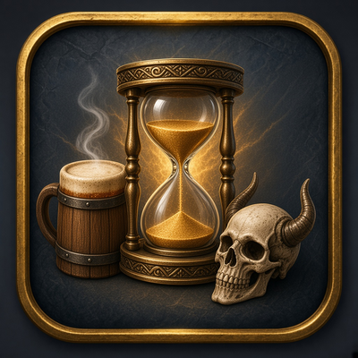
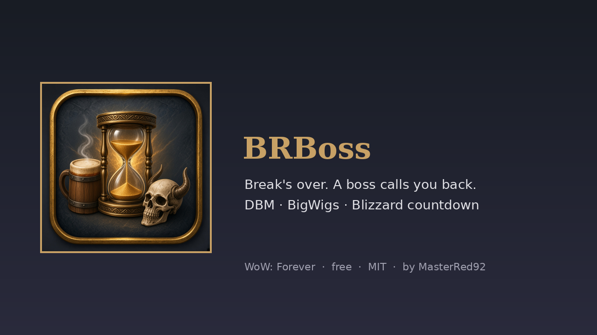
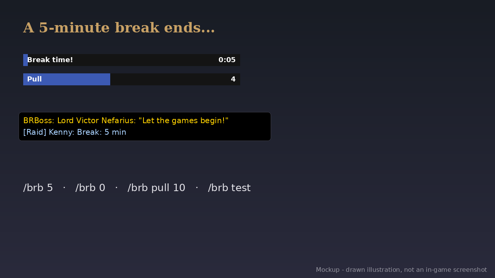

# BRBoss (WoW: Forever) v1.1.0

   

Raid breaks always run long. **BRBoss** waits for the break timer to end and then has a vanilla boss call everyone back. Lord Victor Nefarius says "Let the games begin!", Ragnaros roars "TOO SOON!", and a kobold wants its candle back.

- **Break Quote:** plays when a break timer ends. It hears DBM and BigWigs break timers, from you or anyone in your group. If both addons report the same timer it only plays once, and a cancelled break stays quiet.
- **Pull Quote (option, off by default):** the same idea for pull timers, including Blizzard's own `/countdown`.
- **`/brb 5`:** starts a 5-minute break. If you're leader or assist it starts the real DBM or BigWigs group break. If not, you get a personal bar (BigWigs bar or DBM timer) that only you see.
- **Lines from the game:** boss voice lines that are already in the WoW: Forever client, played by their sound ID. Nothing is bundled.
- **Polite:** never plays in combat or during a boss encounter, throttled to one line a minute, and it can ignore people on your ignore list or only listen to friends and guild.
- **Optional group line:** when you start a break it can post "Break: 5 min" to party or raid. Off by default.

It doesn't send hidden addon messages and doesn't automate anything. It only reacts to timers your boss addon (or the game) already shows you.

**Needs:** Optional: [DBM](https://www.curseforge.com/wow/addons/deadly-boss-mods) or [BigWigs](https://www.curseforge.com/wow/addons/big-wigs). Without either, it still hears Blizzard's own pull countdown.

**Works with:** DBM or BigWigs (required for the timers). Never talks over Wipe & Win Lines, Questie: Job's Done or a Grunt Count countdown.

## Download
- **Wago Addons:** coming at launch (Nov 4). The link goes here when the project is live.
- **CurseForge:** maybe later.
- **GitHub:** [Releases](https://github.com/masterred92/BRBoss/releases) (from the first tagged release) · [Issues](https://github.com/masterred92/BRBoss/issues)
- **More by Kenny:** [WipeAndWin](https://github.com/masterred92/WipeAndWin) · [FloorIsLava](https://github.com/masterred92/FloorIsLava) · [GruntCount](https://github.com/masterred92/GruntCount) · [ParchmentBars](https://github.com/masterred92/ParchmentBars) · [all WoW: Forever addons](https://github.com/masterred92/wow-forever-addons)

## Commands
`/brb` help · `/brb 5` 5-minute break · `/brb 0` cancel · `/brb pull 10` pull timer · `/brb test` (`/brb test pull`) · `/brb mute` · `/brb options`. The options are also in Esc > Options > AddOns > BRBoss, and on an LDB launcher (Titan Panel, ChocolateBar and similar).

## Install
Put the `BRBoss` folder in `World of Warcraft\_forever_\Interface\AddOns\` and restart the game or `/reload`.

## In-game test checklist (launch day)
1. BRBoss is in the AddOns list with its icon and isn't marked out of date.
2. `/brb test` plays a boss line with a subtitle in chat. Note whether each line in the options cycle button matches its label.
3. With DBM: `/dbm break 1` (as leader, or solo). After 60 s one line plays. With BigWigs too, still only one line.
4. `/brb 1` as a non-leader in a group: a personal bar appears and a line plays when it ends.
5. `/brb 0` during a break: no line at the end.
6. Turn on Pull Quote, then use `/countdown 5` or a DBM/BigWigs pull: a line plays at 0. Nothing plays while you're in combat.
7. `/reload` and log out/in: settings are kept (Forever has had a SavedVariables-on-login bug in other addons).

## Licence
MIT. Written from scratch; no code copied from other addons. Free, no paid features. It doesn't automate gameplay: everything it does is a reaction you can see or something you typed.

## Development
`tests/run.sh [path-to-wow-ui-source-forever]` runs `luac -p`, luacheck, the mock-client tests and (with a path) an API check against Blizzard's Forever UI source and the host addons' source. GitHub Actions runs the tests on every push. The release workflow is a manual dry run that builds the zip with [BigWigsMods/packager](https://github.com/BigWigsMods/packager); publishing is switched off until the Wago project ID is added (see the comments in `.github/workflows/release.yml`).
